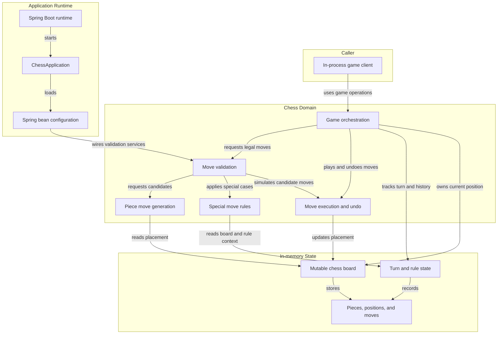
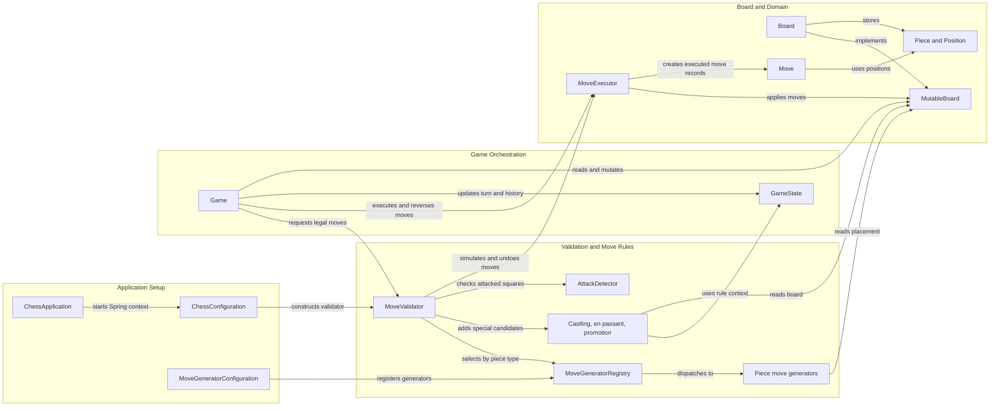

# Architecture Diagram

This project is an in-process chess engine packaged as a Spring Boot application. Its core exposes game, board, move generation, and validation components; the repository does not currently define a user interface, HTTP controllers, or persistent storage.

## Application Architecture

<!-- mermaid-checked: no \n, no em-dash/en-dash, no {} in labels, subgraphs are id["label"], arrows are -->|"label"|, all subgraphs closed by end, ids unique -->

### Technology Stack Summary

| Layer | Technology | Version | Purpose |
|---|---|---|---|
| Language and runtime | Java | 21 | Implements the chess engine and application entry point |
| Application framework | Spring Boot | 4.1.1 | Application startup and dependency configuration |
| Web framework dependency | Spring MVC starter | Managed by Spring Boot 4.1.1 | Included in the build; no HTTP controller or web endpoint is currently defined |
| Build | Gradle Wrapper | 9.8.1 | Compiles the project and runs its JUnit Platform tests |
| Domain | Project Java packages | Not applicable | Game state, board operations, move generation, validation, and execution |

### Data Storage & External Services

The board and game state are held in memory for each `Game` instance. The project has no database, cache, message broker, or external API integration; move history is maintained in memory and supports undo. Although the web MVC starter is a build dependency, no HTTP-facing components are present in the inspected source.

### Key Architectural Decisions

- Board read and write capabilities are separated into `BoardReader` and `BoardWriter`, combined by `MutableBoard`.
- Move generation is selected by piece type through a registry, while castling, en passant, and promotion are added through special-move rules.
- Legal-move validation simulates candidate moves on the mutable board and undoes them to check king safety; the game separately records state snapshots for game-level undo.

## Component Relationships

<!-- mermaid-checked: no \n, no em-dash/en-dash, no {} in labels, subgraphs are id["label"], arrows are -->|"label"|, all subgraphs closed by end, ids unique -->

### Component Inventory

| Component | Layer | Type | Responsibility |
|---|---|---|---|
| `ChessApplication` | Application setup | Spring Boot entry point | Starts the Spring application context |
| `ChessConfiguration` | Application setup | Spring configuration | Provides move execution, attack detection, special rules, and the validator |
| `MoveGeneratorConfiguration` | Application setup | Spring configuration | Registers piece-specific move generators |
| `Game` | Game orchestration | Domain service | Coordinates legal-move queries, play, history, and undo |
| `GameState` | Game orchestration | Domain state and rule context | Tracks the active side, castling rights, en passant, move counters, and move history |
| `MoveValidator` | Validation and move rules | Domain service | Builds pseudo-legal candidates and filters them for chess legality and king safety |
| `AttackDetector` | Validation and move rules | Domain service | Determines whether a square is attacked |
| `MoveGeneratorRegistry` | Validation and move rules | Strategy registry | Selects the generator for a piece type |
| Piece move generators | Validation and move rules | Strategy implementations | Generate normal candidate moves for each piece type |
| Castling, en passant, promotion rules | Validation and move rules | Rule strategies | Add or transform special-move candidates |
| `MutableBoard` | Board and domain | Board interface | Combines read-only placement queries and board mutations |
| `Board` | Board and domain | In-memory implementation | Stores the 8-by-8 piece placement and provides board operations |
| `MoveExecutor` | Board and domain | Domain service | Applies and reverses normal and special moves |
| `Move` | Board and domain | Domain value | Represents a move choice, including special move kind and promotion type |
| `Piece` and `Position` | Board and domain | Domain values | Represent chess pieces and validated board coordinates |
