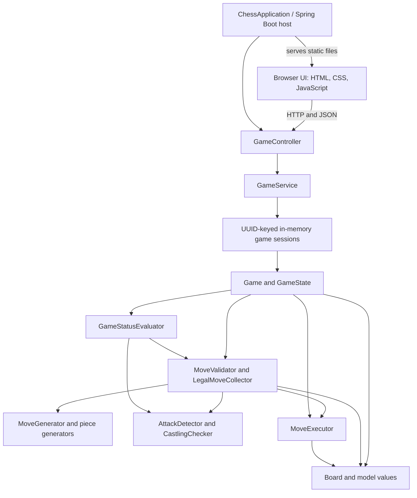
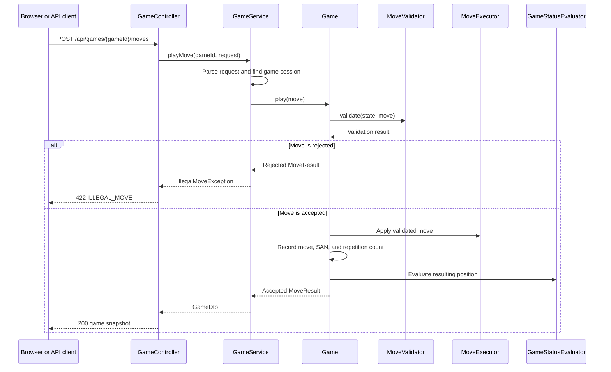

# Chess Engine

A Java 21 chess rules engine with a Spring Boot REST API and a browser-based, two-player chess interface. The browser handles presentation; the engine generates legal moves, applies accepted moves, tracks game history, and evaluates the position after each move.

Repository: https://github.com/md2004sameer/Chess

## What is implemented

- Pseudo-legal move generators for all six piece types, followed by legal-move filtering and king-safety checks.
- Castling, en passant, pawn promotion, check, checkmate, and stalemate.
- Threefold-repetition and fifty-move draw claims, plus automatic fivefold-repetition and seventy-five-move draws.
- Insufficient-material detection for a defined subset of positions.
- Move history in coordinate form and generated Standard Algebraic Notation (SAN).
- A REST API for independent games, legal moves, draw claims, resignation, and move history.
- A static browser UI with legal-destination hints, promotion choices, board flipping, game status, and move history.
- Unit and API tests, including perft counts for established reference positions.
- Dockerfile and Docker Compose configuration.

The engine is not a chess-playing AI. It does not evaluate moves strategically or choose moves for a player.

## Technology stack

| Area | Technology |
|---|---|
| Language | Java 21 |
| Backend | Spring Boot 4.1.1, Spring MVC |
| Build | Gradle Wrapper 9.8.1 |
| Dependency management | Spring Dependency Management 1.1.7 |
| Tests | JUnit Jupiter, Spring MVC test support, JUnit Platform |
| Frontend | HTML, CSS, vanilla JavaScript |
| Container | Docker, Docker Compose |

The frontend has no separate package manager or build step. The Spring Boot application serves the files in `src/main/resources/static`.

## Architecture

The core chess packages are separate from Spring's HTTP layer. The API translates JSON into domain values and maps results back to DTOs; the engine itself works with game state, board positions, and moves.



### Main responsibilities

| Package or class | Responsibility |
|---|---|
| `ChessApplication` | Starts the Spring Boot host. |
| `api.GameController` | Defines the HTTP endpoints under `/api/games`. |
| `api.GameService` | Creates and looks up games, synchronizes operations per game, validates request data, and maps engine values to API DTOs. |
| `api.dto` | Defines the request, game, piece, move, and error JSON shapes. |
| `api.error` | Maps expected client errors to HTTP status codes and stable error codes. |
| `board.Board` | Stores the 8x8 grid. It does not decide whether a move is legal. |
| `game.Game` | Coordinates move validation, execution, move history, SAN, repetition tracking, draw claims, and game status. |
| `game.GameState` | Holds the board, side to move, castling rights, en-passant target, move counters, and status. |
| `model` | Defines values such as `Piece`, `Position`, `Move`, `Color`, `CastlingRights`, and `GameStatus`. |
| `movegen` | Generates pseudo-legal moves for each piece type. |
| `engine.MoveValidator` | Checks coordinates, ownership and turn, movement patterns, promotion, castling, and king safety. |
| `engine.AttackDetector` | Determines whether a square is attacked and whether a king is in check. |
| `engine.MoveExecutor` | Applies a validated move and updates turn, castling rights, en-passant metadata, and counters. |
| `engine.GameStatusEvaluator` | Detects checkmate, stalemate, and implemented automatic draw conditions. |

### Move execution

The game validates a move before applying it to the live state. King-safety checks execute candidates against a copied state, so a rejected move does not partially change the current game. The service also synchronizes operations on the same game session to prevent two requests from successfully playing the same turn.



## Chess rules and state

The board is stored as an 8x8 array. Row 0 represents rank 8, row 7 represents rank 1, and column 0 represents file `a`. API square names use algebraic coordinates such as `e2` and `e4`.

| Rule or capability | Implementation status |
|---|---|
| Pawn, knight, bishop, rook, queen, and king movement | Implemented as pseudo-legal generation, then filtered for legal moves. |
| Captures and protection against capturing the opposing king | Implemented. |
| Check detection and king safety | Implemented; candidate moves are simulated on a copy before acceptance. |
| Kingside and queenside castling | Implemented with rights, rook presence, path clearance, and attacked-square checks. |
| En passant | Implemented, including its effect on the resulting position and king-safety validation. |
| Promotion | Implemented to queen, rook, bishop, or knight. The API requires a promotion choice for a pawn reaching the last rank. |
| Checkmate and stalemate | Implemented. |
| Fifty-move and threefold-repetition claims | Implemented as claims, not automatic draws. |
| Seventy-five-move and fivefold-repetition draws | Implemented as automatic draw conditions. |
| Insufficient material | Partially covered by a conservative detector: bare kings, one minor piece, and bishop-only positions where all bishops are on the same square color. Other material combinations are not fully adjudicated. |
| SAN move history | Implemented for ordinary moves, captures, disambiguation, castling, promotion, check, and checkmate. |
| Tournament certification or complete FIDE-rule verification | Not established by this repository. Passing tests is evidence for the tested positions, not a certification of complete rule compliance. |
| Chess AI, clocks, undo, FEN/PGN import or export | Not implemented. |

Each `Game` owns its state and history. Its constructor copies the supplied state; `getState()` and `board()` return copies for inspection. Callers should submit moves through `Game.playMove()` rather than changing a returned snapshot.

Position repetition keys include the board placement, side to move, castling rights, and an en-passant target only when a legal en-passant capture is available. Three occurrences make a draw claim available; five occurrences trigger the implemented automatic draw rule. The fifty-move claim threshold is 100 half-moves without a pawn move or capture, while the automatic seventy-five-move threshold is 150 half-moves.

## REST API

The API is served by the same application as the frontend. All routes are relative to the application's origin.

| Method | Route | Request | Successful response |
|---|---|---|---|
| `POST` | `/api/games` | No body required | `201 Created`; a new game snapshot and a `Location` header pointing to `/api/games/{gameId}`. |
| `GET` | `/api/games/{gameId}` | UUID path parameter | `200 OK`; current game snapshot. |
| `GET` | `/api/games/{gameId}/legal-moves` | UUID path parameter | `200 OK`; array of all legal moves for the active side, or an empty array when the game is over. |
| `POST` | `/api/games/{gameId}/moves` | Move request JSON | `200 OK`; updated game snapshot. |
| `GET` | `/api/games/{gameId}/moves` | UUID path parameter | `200 OK`; accepted moves in coordinate form. |
| `POST` | `/api/games/{gameId}/draw` | No body required | `200 OK` if a fifty-move or threefold-repetition draw is claimable. |
| `POST` | `/api/games/{gameId}/resign` | No body required | `200 OK`; game status becomes `RESIGNED`. |

### Move request

The `from` and `to` fields must be valid algebraic squares. `promotion` is optional for ordinary moves and accepts one of `q`, `r`, `b`, or `n`; letter case is ignored.

```json
{
  "from": "e2",
  "to": "e4"
}
```

To promote a pawn, send the promotion choice:

```json
{
  "from": "e7",
  "to": "e8",
  "promotion": "q"
}
```

The promotion example is valid JSON; it is a legal chess move only when the referenced game is at a position where the pawn can move from `e7` to `e8`.

### Game snapshot

A game response contains these fields:

- `gameId`: UUID string.
- `status`: one of `ACTIVE`, `CHECK`, `CHECKMATE`, `RESIGNED`, `STALEMATE`, `DRAW_FIFTY_MOVE`, `DRAW_THREEFOLD_REPETITION`, `DRAW_INSUFFICIENT_MATERIAL`, `DRAW_SEVENTY_FIVE_MOVE`, or `DRAW_FIVEFOLD_REPETITION`.
- `activeColor`: `WHITE` or `BLACK`.
- `board`: 8 rows of 8 cells, with rank 8 first and file `a` first in each row. Empty squares are `null`; occupied squares use `color`, `type`, and `symbol`.
- `moveCount`: number of accepted plies, so one move by White increments it to 1.
- `canClaimDraw`: whether the current position meets the fifty-move or threefold-repetition claim threshold.
- `sanHistory`: SAN notation for accepted moves in order.

For example, the start of a game has the following board and state. The example uses the actual 8x8 response shape.

```json
{
  "gameId": "7ad9d826-5b52-49d4-a25c-b3ff3b5f58b0",
  "status": "ACTIVE",
  "activeColor": "WHITE",
  "board": [
    [
      {"color":"BLACK","type":"ROOK","symbol":"r"},
      {"color":"BLACK","type":"KNIGHT","symbol":"n"},
      {"color":"BLACK","type":"BISHOP","symbol":"b"},
      {"color":"BLACK","type":"QUEEN","symbol":"q"},
      {"color":"BLACK","type":"KING","symbol":"k"},
      {"color":"BLACK","type":"BISHOP","symbol":"b"},
      {"color":"BLACK","type":"KNIGHT","symbol":"n"},
      {"color":"BLACK","type":"ROOK","symbol":"r"}
    ],
    [
      {"color":"BLACK","type":"PAWN","symbol":"p"},
      {"color":"BLACK","type":"PAWN","symbol":"p"},
      {"color":"BLACK","type":"PAWN","symbol":"p"},
      {"color":"BLACK","type":"PAWN","symbol":"p"},
      {"color":"BLACK","type":"PAWN","symbol":"p"},
      {"color":"BLACK","type":"PAWN","symbol":"p"},
      {"color":"BLACK","type":"PAWN","symbol":"p"},
      {"color":"BLACK","type":"PAWN","symbol":"p"}
    ],
    [null, null, null, null, null, null, null, null],
    [null, null, null, null, null, null, null, null],
    [null, null, null, null, null, null, null, null],
    [null, null, null, null, null, null, null, null],
    [
      {"color":"WHITE","type":"PAWN","symbol":"P"},
      {"color":"WHITE","type":"PAWN","symbol":"P"},
      {"color":"WHITE","type":"PAWN","symbol":"P"},
      {"color":"WHITE","type":"PAWN","symbol":"P"},
      {"color":"WHITE","type":"PAWN","symbol":"P"},
      {"color":"WHITE","type":"PAWN","symbol":"P"},
      {"color":"WHITE","type":"PAWN","symbol":"P"},
      {"color":"WHITE","type":"PAWN","symbol":"P"}
    ],
    [
      {"color":"WHITE","type":"ROOK","symbol":"R"},
      {"color":"WHITE","type":"KNIGHT","symbol":"N"},
      {"color":"WHITE","type":"BISHOP","symbol":"B"},
      {"color":"WHITE","type":"QUEEN","symbol":"Q"},
      {"color":"WHITE","type":"KING","symbol":"K"},
      {"color":"WHITE","type":"BISHOP","symbol":"B"},
      {"color":"WHITE","type":"KNIGHT","symbol":"N"},
      {"color":"WHITE","type":"ROOK","symbol":"R"}
    ]
  ],
  "moveCount": 0,
  "canClaimDraw": false,
  "sanHistory": []
}
```

The legal-moves and move-history endpoints return `MoveDto` objects with `from`, `to`, and `promotion`. An ordinary move has a `null` promotion field:

```json
[
  {"from": "e2", "to": "e4", "promotion": null}
]
```

This is an example of the response item shape, not the full opening legal-move list.

### Calling the API

Create a game:

```bash
curl -i -X POST http://localhost:8080/api/games -H "Accept: application/json"
```

Submit a move using the UUID returned in the creation response:

```bash
curl -X POST http://localhost:8080/api/games/7ad9d826-5b52-49d4-a25c-b3ff3b5f58b0/moves \
  -H "Content-Type: application/json" \
  -d '{"from":"e2","to":"e4"}'
```

Get legal moves or move history:

```bash
curl http://localhost:8080/api/games/7ad9d826-5b52-49d4-a25c-b3ff3b5f58b0/legal-moves
curl http://localhost:8080/api/games/7ad9d826-5b52-49d4-a25c-b3ff3b5f58b0/moves
```

Replace the sample UUID with one returned by `POST /api/games`. The game exists only in the current server process.

### Errors and CORS

Expected API errors use this JSON shape:

```json
{
  "code": "ILLEGAL_MOVE",
  "message": "The move does not match the piece's movement rules."
}
```

| HTTP status | Error code | Meaning |
|---|---|---|
| `400 Bad Request` | `INVALID_REQUEST` | Malformed JSON, invalid square or promotion value, missing move body, or malformed UUID path parameter. |
| `404 Not Found` | `GAME_NOT_FOUND` | The UUID is valid but is not present in this process's game registry. |
| `422 Unprocessable Content` | `ILLEGAL_MOVE` | A well-formed move violates chess rules, or a draw is claimed when neither supported claim rule is available. |
| `409 Conflict` | `GAME_FINISHED` | A move, draw claim, or resignation conflicts with a game that has already ended. |

CORS is disabled unless allowed origins are configured. Set `CHESS_CORS_ALLOWED_ORIGINS` to one origin or a comma-separated list. The configuration allows `GET`, `POST`, and `OPTIONS`, the `Accept` and `Content-Type` headers, and exposes `Location`. Credentialed CORS requests are not enabled.

For example, to allow a frontend served from port 3000:

```bash
CHESS_CORS_ALLOWED_ORIGINS=http://localhost:3000 ./gradlew bootRun
```

The included frontend uses the relative API path `api/games` and is served by the same application, so it does not need a separate backend URL or CORS configuration.

## Browser frontend

Open `http://localhost:8080/` after starting the Spring Boot application. The interface supports two people playing on one device; it does not provide network multiplayer or a computer opponent.

The board and game panel are rendered by `src/main/resources/static/app.js`, styled by `styles.css`, and defined in `index.html`. Legal destinations come from the API rather than a second rules implementation in the browser. The UI includes promotion selection, board flipping, claim-draw and resign actions, check and terminal-state messages, and SAN move history.

The current game UUID is kept in the tab's `sessionStorage`. Reloading a tab attempts to reopen that game. Starting a new game replaces the stored UUID. Because the server does not persist games, a restart loses game state; if a saved UUID is no longer found, the frontend creates a new game.

## Run locally

### Prerequisites

- JDK 21.
- Git.
- Docker Engine and the Docker Compose plugin only if using the container setup.

Gradle is not required as a separate installation; use the included wrapper.

### Clone and start

```bash
git clone https://github.com/md2004sameer/Chess.git
cd Chess
./gradlew clean test
./gradlew bootRun
```

The application listens on port 8080 by default.

- Browser UI: http://localhost:8080/
- API root: http://localhost:8080/api/games

There is no Swagger/OpenAPI UI configured. Use the endpoint table and curl examples above to explore the API.

### Build a JAR

```bash
./gradlew bootJar
```

The executable Spring Boot JAR is written under `build/libs/`.

### Run with Docker Compose

```bash
docker compose up --build -d
```

Open http://localhost:8080/. The Compose file maps the container's port 8080 to host port 8080 by default.

To use another host port:

```bash
CHESS_PORT=8081 docker compose up --build -d
```

To configure CORS for an independently hosted frontend:

```bash
CHESS_CORS_ALLOWED_ORIGINS=https://frontend.example.com docker compose up --build -d
```

View logs and stop the container:

```bash
docker compose logs -f chess
docker compose down
```

The Dockerfile uses a Java 21 JDK image to build the JAR and a Java 21 JRE image to run it as a non-root user.

## Tests

Run all tests:

```bash
./gradlew test
```

Or run the full verification task:

```bash
./gradlew check
```

To run a focused test class:

```bash
./gradlew test --tests 'com.sameer.chess.movegen.PerftTests'
./gradlew test --tests 'com.sameer.chess.api.GameControllerTests'
```

The test suite covers:

- **Move generation:** separate tests for pawns, knights, bishops, rooks, queens, kings, and the move-generator factory.
- **Move legality:** attack detection, invalid moves, active-side ownership, king safety, and legal-move API behavior.
- **Special and terminal rules:** castling, en passant, promotion, checkmate, stalemate, draw claims, automatic draw conditions, resignation, and game lifecycle.
- **State and history:** defensive snapshots, independent game state, position repetition, move history, and SAN notation.
- **HTTP contract:** controller and service behavior, DTO shape, malformed requests, error status codes, draw and resignation routes, and CORS configuration.
- **Perft:** counts for the initial position, Kiwipete, an endgame position, a promotion/check-evasion position, and a tactical position.

The perft tests compare generated legal-move-tree counts with reference values. For example, the initial position is tested at 20, 400, and 8,902 nodes at depths 1, 2, and 3; Kiwipete is tested at 48, 2,039, and 97,862 nodes. These tests are useful checks of move generation, but they do not by themselves establish complete chess-rule correctness.

## Project layout

```text
.
├── build.gradle
├── settings.gradle
├── gradlew
├── gradle/wrapper/
├── Dockerfile
├── compose.yaml
└── src
    ├── main
    │   ├── java/com/sameer/chess
    │   │   ├── api/       # REST controller, service, DTOs, error mapping, CORS
    │   │   ├── board/     # 8x8 board representation
    │   │   ├── engine/    # validation, attacks, execution, status evaluation
    │   │   ├── game/      # game lifecycle, state, history, draw rules
    │   │   ├── model/     # domain values and enums
    │   │   └── movegen/   # per-piece pseudo-legal move generators
    │   └── resources
    │       ├── application.properties
    │       └── static/
    │           ├── index.html
    │           ├── styles.css
    │           └── app.js
    └── test/java/com/sameer/chess/
        ├── api/
        ├── engine/
        ├── game/
        ├── model/
        ├── movegen/
        └── util/
```

## Limitations and possible next steps

- Games and their move history are stored in memory. A server restart clears them, and multiple application instances would not share game state.
- The API has no authentication, persistence, matchmaking, or multiplayer coordination. The browser UI is for two players sharing one device.
- Insufficient-material detection does not cover every theoretical dead position.
- Chess clocks, undo, FEN/PGN import and export, and a computer opponent are possible future additions, not current features.
- No `LICENSE` file is present in the inspected repository tree. Check licensing before redistributing or reusing the code.
