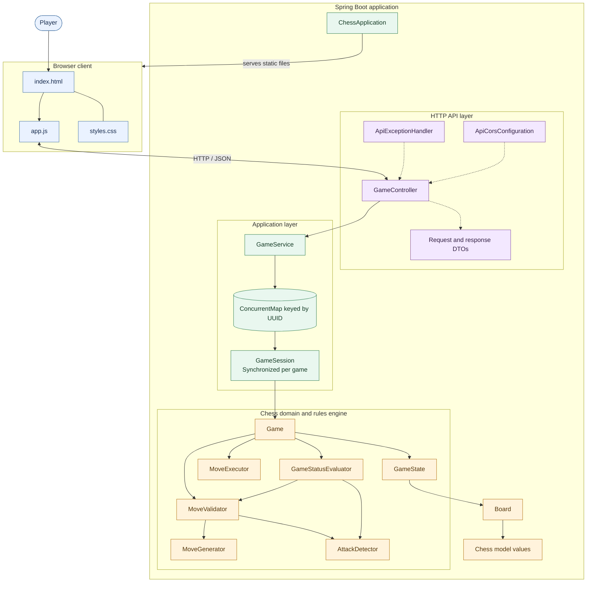

# Chess Engine — System Architecture

This diagram shows how the browser, Spring Boot API, game-session management, and chess rules engine connect. It is intentionally limited to the system structure; class relationships are documented separately in [Class Diagram](class-diagram.md) and [Chess Engine Class Diagram](chess-engine-class-diagram.md).

## Key design facts

- Each game is stored under its own UUID in an in-memory registry.
- Service operations synchronize on the matching game session so concurrent requests do not advance the same game at once.
- The Spring Boot application serves both the static browser UI and the REST API.
- Active games are not stored in a database. Restarting the application clears all current game sessions.
- The chess engine enforces rules; it does not select strategic moves like a chess AI.

## View in an editor

GitHub renders this Mermaid diagram when the file is opened. In VS Code, open this file and use `Cmd+Shift+V` on macOS or `Ctrl+Shift+V` on Windows/Linux to preview it.
