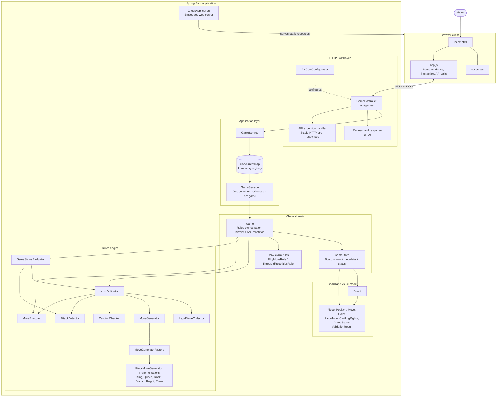
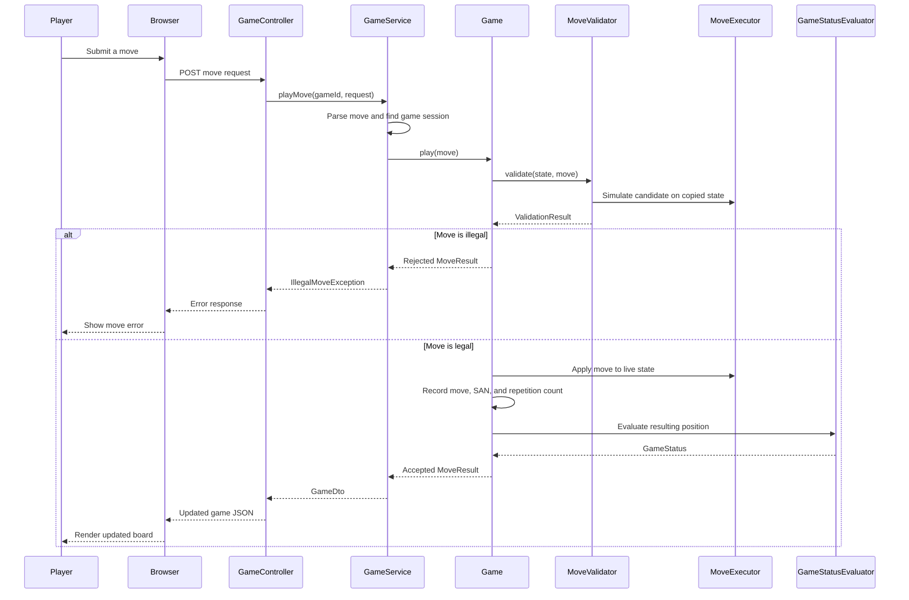
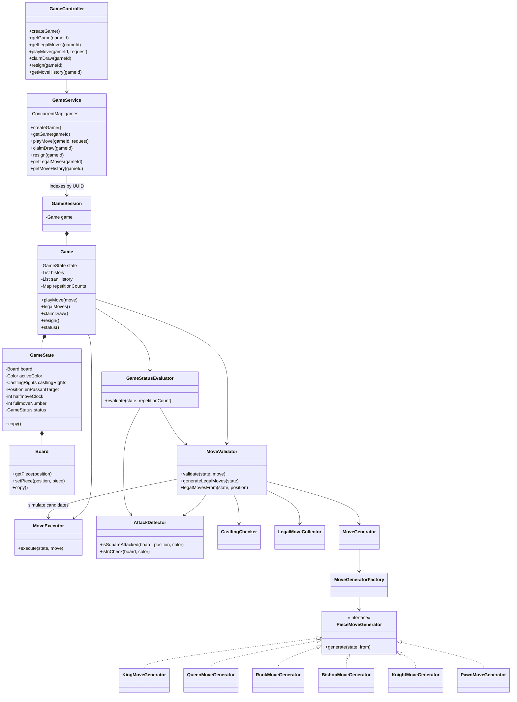

# Chess Engine — Architecture

This document maps the current `main` branch of [md2004sameer/Chess](https://github.com/md2004sameer/Chess). It covers the web application, REST API, game-session management, chess domain, move-generation pipeline, and move lifecycle.

## 1. System architecture

### Layer responsibilities

| Layer | Main components | Responsibility |
|---|---|---|
| Browser | `index.html`, `styles.css`, `app.js` | Render the board, handle player input, show legal moves/status/history, and call the API |
| HTTP API | `GameController`, DTOs, API error classes | Expose REST endpoints and translate HTTP requests/responses |
| Application | `GameService`, `GameSession` | Find/create independent games, validate request fields, map engine values to DTOs, and synchronize access per game |
| Domain | `Game`, `GameState`, draw-rule classes | Own a match's state and history; coordinate validation, execution, notation, repetition, draw claims, and game status |
| Rules engine | `MoveValidator`, `MoveExecutor`, `AttackDetector`, `GameStatusEvaluator` | Validate legal moves, apply moves, detect attacks/check, and evaluate terminal positions |
| Move generation | `MoveGenerator`, `MoveGeneratorFactory`, piece generators | Generate pseudo-legal movement patterns for each piece type |
| Core model | `Board` and `model` package | Store the board and represent pieces, moves, positions, colors, castling rights, and status |

## 2. Move lifecycle

This flow shows how `POST /api/games/{gameId}/moves` travels through the browser, API, game service, and chess engine.

King-safety validation simulates candidate moves against a copied game state. The live state is changed only after the move has passed validation.

## 3. Core class relationships

## 4. Concurrency and persistence

- **Independent games:** `GameService` assigns each game a UUID and stores a separate `GameSession` in a `ConcurrentMap`.
- **Per-game synchronization:** service operations synchronize on the matching session, preventing competing requests from advancing the same game simultaneously.
- **In-memory only:** active games and move histories are not persisted to a database. Restarting the application clears the game registry and active games.
- **No chess AI:** the engine enforces chess rules and reports legal moves; it does not choose strategic moves for a player.

## 5. Tests and deployment

- Tests are grouped around API contracts, controller/service behavior, move validation, move generation, game status and lifecycle, draw rules, notation, and board behavior. Perft tests exercise move-generation correctness against known positions.
- The Spring Boot application serves the frontend from `src/main/resources/static`; there is no separate frontend build step.
- `Dockerfile` and `compose.yaml` support containerized execution.

## View the diagrams

- **GitHub:** open this file; Mermaid diagrams render automatically.
- **VS Code:** open the Markdown file and press `Cmd+Shift+V` (macOS) or `Ctrl+Shift+V` (Windows/Linux). Use `Cmd+K V` / `Ctrl+K V` to open the preview beside the source.
