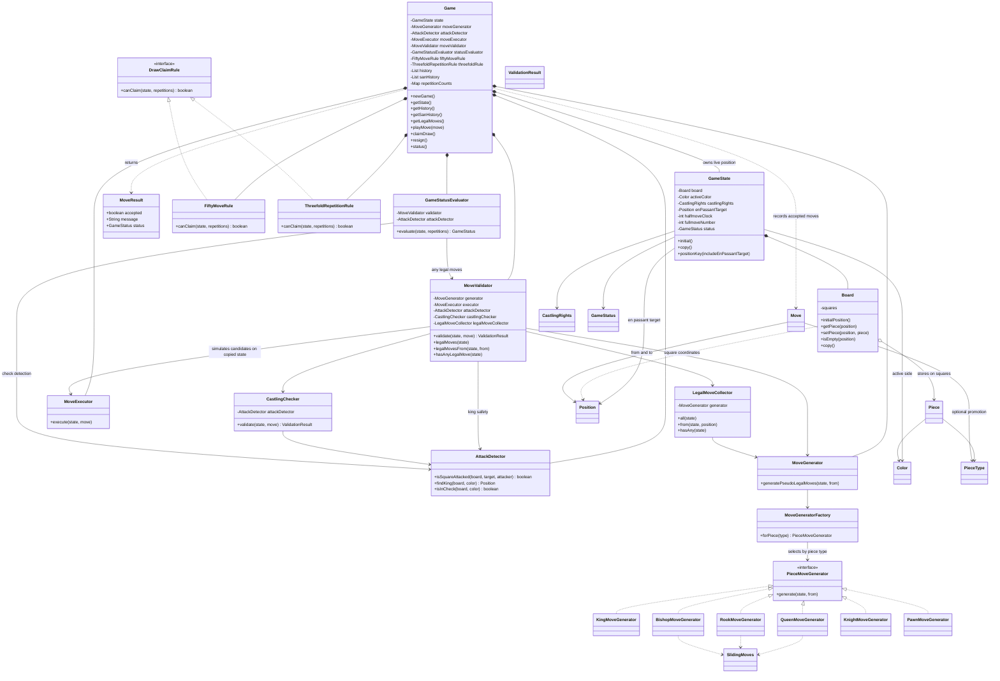

# Chess Engine — Game and Rules Class Diagram

This diagram isolates the chess rules engine from the Spring Boot API and browser. It follows the code under `com.sameer.chess.game`, `engine`, `movegen`, `board`, and `model`.

For the overall application layers, see [System Architecture](architecture.md). For the API and application classes, see [Application Class Diagram](class-diagram.md).

## The game flow at a glance

1. `Game.playMove()` asks `MoveValidator` to validate the requested move.
2. `MoveValidator` checks coordinates, ownership and turn, promotion, movement patterns, castling, and king safety.
3. For king-safety checks, candidate moves are applied to a copied `GameState`; the live game is not changed by a rejected move.
4. After validation succeeds, `MoveExecutor` updates the live state, including the board, active side, castling rights, en-passant target, and move counters.
5. `Game` records move history and SAN notation, updates repetition counts, and calls `GameStatusEvaluator`.
6. `GameStatusEvaluator` checks for legal moves, check, checkmate, stalemate, and automatic draw conditions. Draw claims for the fifty-move and threefold-repetition rules are handled by their rule classes.

## Design boundaries

- `Board` stores pieces; it does not determine whether a move is legal.
- `MoveGenerator` produces pseudo-legal moves. `MoveValidator` filters candidates using the full rules and king-safety checks.
- `MoveExecutor` applies a move after validation. Callers should use `Game.playMove()`, not execute moves directly.
- `GameState.copy()` and board copies support safe simulation and read-only snapshots.
- The engine has no dependency on Spring MVC, HTTP DTOs, or the browser UI.

## View in an editor

GitHub renders the Mermaid class diagram automatically. In VS Code, open this file and use `Cmd+Shift+V` on macOS or `Ctrl+Shift+V` on Windows/Linux.
