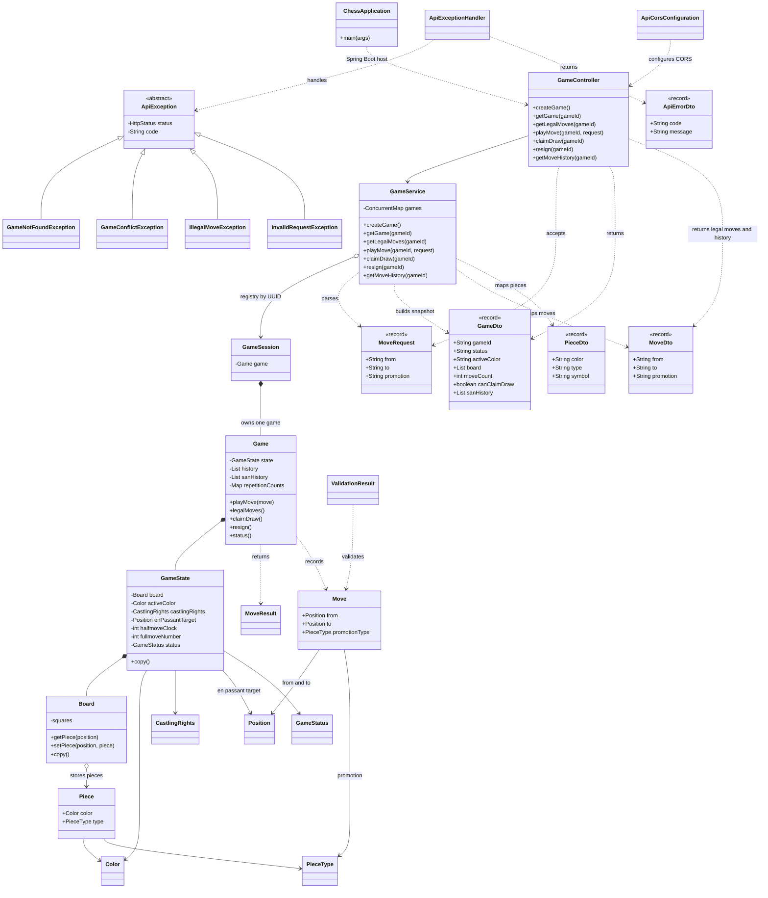

# Chess — Application Class Diagram

This diagram focuses on relationships across the REST API, game-session service, domain model, and errors. For the internals of move validation and chess rules, see the [Chess Engine Class Diagram](chess-engine-class-diagram.md). For the system layers, see [System Architecture](architecture.md).

## Reading the diagram

- **API and service:** `GameController` exposes HTTP routes; `GameService` owns the UUID-keyed registry and maps engine values to API DTOs.
- **One game per session:** every `GameSession` owns one `Game`. A session is synchronized when the service reads or changes that game.
- **Game state:** `Game` coordinates the rules and move history. `GameState` holds a position and its metadata; `Board` stores pieces but does not decide move legality.
- **Errors:** API-specific exceptions inherit from `ApiException` and are converted to consistent error responses.

## View in an editor

GitHub renders the Mermaid class diagram automatically. In VS Code, open this file and use `Cmd+Shift+V` on macOS or `Ctrl+Shift+V` on Windows/Linux.
